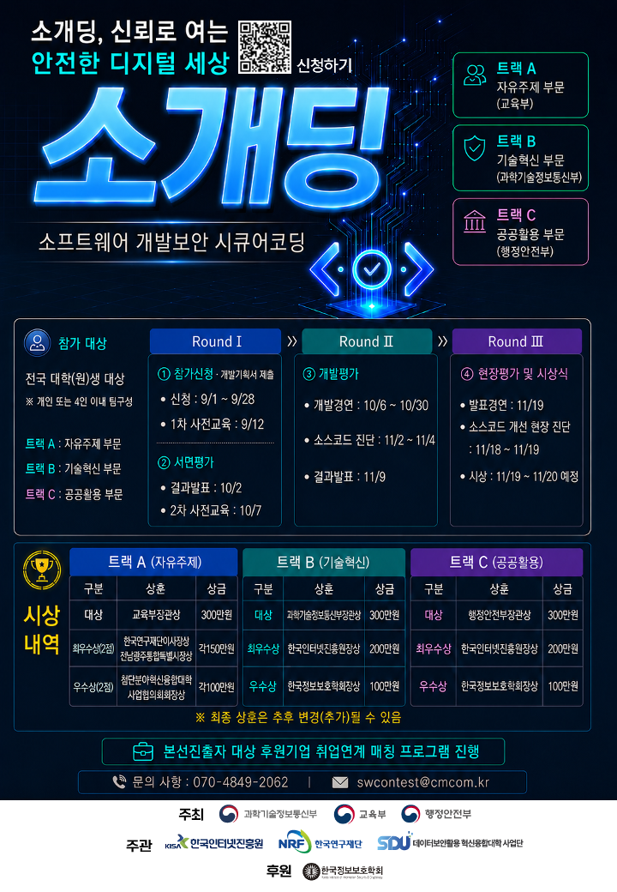
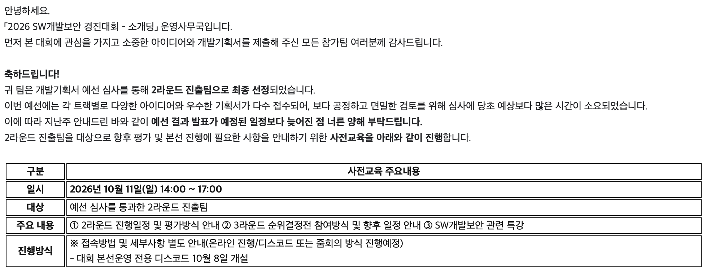
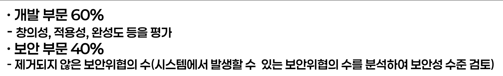
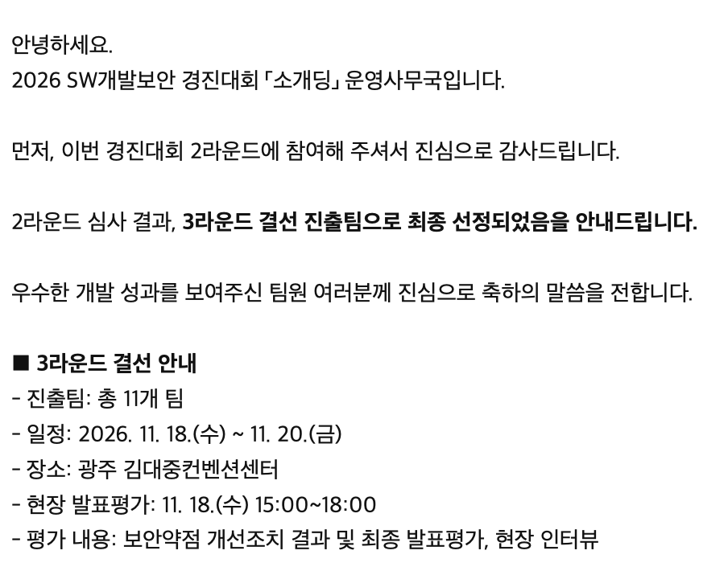
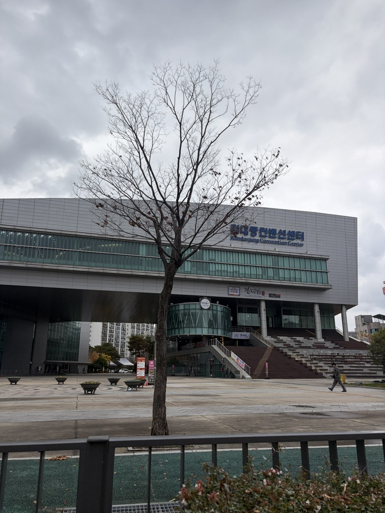
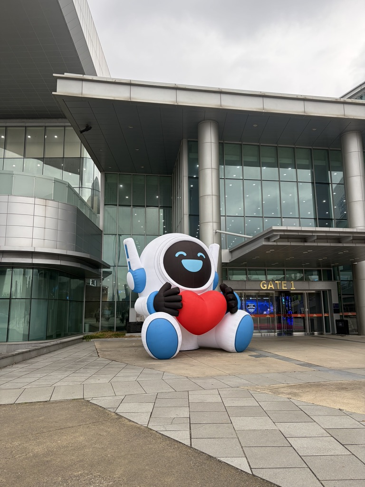
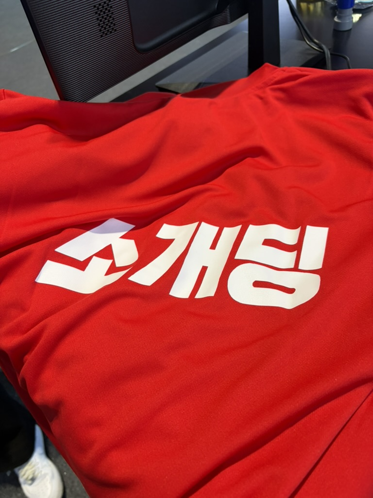
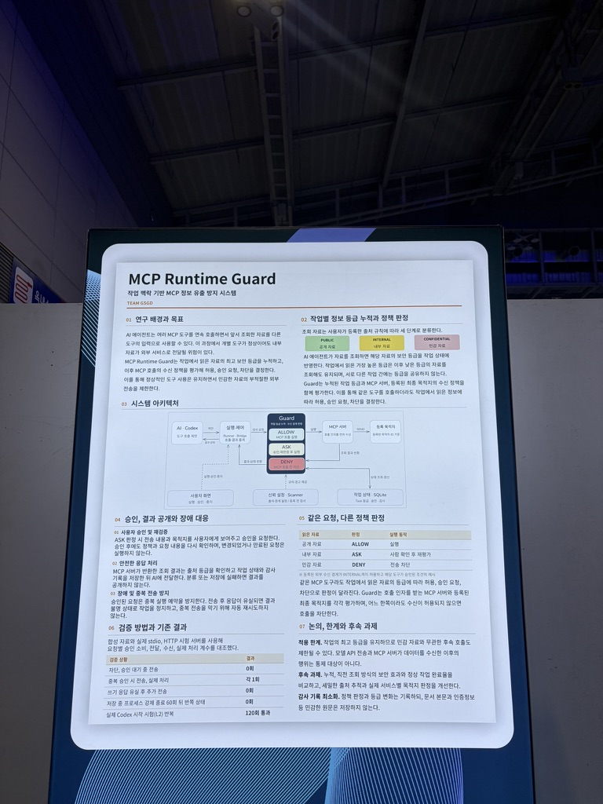
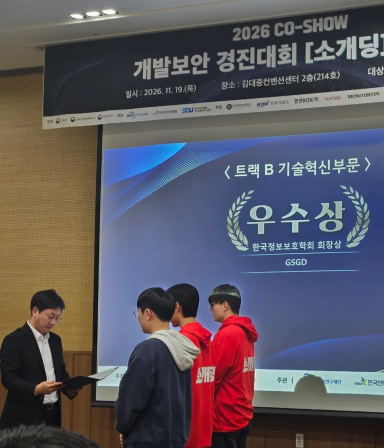

## 0. 개요

26년 11월 KISA 에서 주관하는 <code>소프트웨어 개발보안 경진대회</code>(소개딩)에 참여해서 우수상을 수상했다.

첫 외부 경진대회이고, 대형 개발 경험도 없었던지라 기대도 안 하고 나가본 대회였는데, 팀원과 열심히 노력해 어찌 3라운드까지 올라와서 수상까지 한 정말 뜻깊은 경험이였다. 어떻게 준비해서 수상까지 이어졌는지 기록하고자 한다.

## 1. 참가 신청 (Round 1)

합이 맞는 같은 학과 동기들과 팀을 꾸려 아이디어 회의를 했다. 우리 팀은 개발, 특히 시큐어 코딩 경험은 없던지라 열심히 AI와 토론을 하여 아이디어를 도출했다.

기술혁신 위주로 아이디어를 냈고 내가 평소에 연구하던 LLM Agent보안에서 MCP 보안 관련 아이디어를 냈다. mcp를 사용하다가 정보 유출이 날 수 있는 환경을 원체 차단하는 서비스를 제작하는 아이디어였다.

지원서는 개발기획서를 쓰는 것으로 우리가 개발할 서비스의 기능도와 아키텍처를 기입했다. 시큐어코딩 대회인 것을 감안하여 보안을 얼마나 고려했는지에 대한 내용을 중점으로 작성했다.

## 2. 개발 기간 (Round 2)

다행히 2라운드에 진출해 팀원들과 작전회의를 가졌다. 총 29팀이 올라왔고, 본선에 올라오는 팀은 B트랙 기준 3팀뿐이였다.

심사 기준은 다음과 같다. 보안 부문이 무려 40퍼센트였다.

2라운드는 무려 3주간 개발 시간이 주어졌기에 상대 팀들 퀄리티가 매우 높을 것으로 판단하고 어떻게 퀄리티를 높일지 고민을 많이 했다. 개발 회의를 하면서 구조를 1라운드에 썼던 아키텍쳐 구조를 거의 갈아엎었다.

우리가 세운 작전은 다음과 같다.

1. 각자 개발 구역을 맡고, 서로 검증하자. (기능 버그, 보안)
2. 몰아서 하지 말고 꾸준히 돌리고 소통하자.

하지만 우리는 최강의 대학생… 시험기간이 겹쳐서 2번이 잘 지켜지지 않았다… 결국 마지막 제출 전날부터 당일까지 밤을 세는 유사 해커톤 행위를 했다.

소스코드, 발표자료, 서비스개요서, 개발기획서, 시연영상을 제출해야했다. (낼 거 너무 많았던 ㅡㅡ)..

24시간 무호흡 코딩을 했으나, 결과물이 내 기준 너무 별로였다.. 자책하면서 일단 제출을 했다.

## 3-1. 본선진출 (Round 3)

아쉬운 제출물을 뒤로하고 평화로운 날을 보내고 있었는데, 뜬금없이 최종 제출 후 4일뒤 저녁 6시에 3라운드 최종 선정 메일이 날라왔다. 솔직히 아에 될 줄 몰랐는데 너무 기뻤다 !!

운영사무국에서 보안진단서를 보내주었다. 우리는 오류 정보 노출 2건이 나왔고, 그 외에는 나오지 않았다. 아마 보안 점수에서 크게 먹고가지 않았나 생각이 들었다.

3라운드에는 개선된 소스코드, 발표자료를 다시 만들어 내야했다. 소스코드 개선은 할 게 크게 없었고, 기존에 레전드 밤티였던 발표자료를 사람의 손길로 열심히 만들어냈다.

## 3-2. CO-SHOW

11.18에 광주 김대중컨벤션센터로 갔다. 레전드로 큰 코스 마스코트가 반겨주었다.

CO-SHOW는 coss 컨소시엄 대학들이 전부 모여 부스 운영을 한다. 소개딩은 데이터보안활용융합 사업단 대회로, 3라운드 참가자인 우리도 부스 운영을 해야 했다. 

손님이 오시면 우리 서비스에 대한 설명을 했다. 우리 주제는 너무 심오해서 손님들이 별로 좋아하지는 않으셨다…소프트웨어 전공자가 오시면 되게 흥미롭게 보셨던 기억이 있다. 

당일 4시쯤 발표를 했다. 발표장소는 어떤 강의실 같은 곳에서 심사위원 약 10여명에게 심사를 받았다. 발표시간은 총 8분, 질답 시간은 7분이였다. 

발표는 팀원이 해주었고, 나는 주로 질답을 디펜스하는 역할을 맡았다. 질문은 거의 예상범주에서 나왔으나, 대답을 나이스하게 하지 못하였다. 나의 부족함이 너무 잘 느껴지는 시간이였다.

그 후 인터뷰시간이 있었다. 나는 처음에 인터뷰라고 해서 가벼운 질문셋으로 이루어질 것으로 예상했으나, 그게 아니였다.. 기술 얘기가 전부였고, 발표 질답보다 훨씬 힘들었다.

다음날 4시 시상식에서 우수상을 수상하였다.(트랙 내 3등) 

개인적으로 아쉬운 결과라 생각되지만, 상을 받아서 너무 기뻤다.

## 4. 팁

이 대회는 무려 보안 점수가 반을 먹고 가는 대회이다.  그래서 개발 → 보안약점 조치를 했다면 시간이 부족하고, 계속 파생된 버그가 나왔을 것이다.

우리 팀은 개발전에 대회측에서 제공해준 시큐어코딩 관련 문서를 꼼꼼히 점검했다. 개발 기획서를 꼼꼼하게 수정하고, AI한테 프롬프팅을 관련 자료를 전부 컨텍스트에 넣었고, 팀원이 서로 검증했다.

그 결과 코드 12만줄에 보안 약점 0건인 결과를 만들었다. 보안 점수가 이론상 만점이였을 것이다. 이 점수가 본선 진출에 큰 기여를 했다.

결론적으로는 열심히 AI와 토론하여 보안 약점을 최대한 없애는 개발 기획을 하는 게 중요했다.

서비스 퀄리티도 몰론 중요하다. 당연한 얘기지만 지원서를 열심히 쓰는 것이 중요했던 거 같다. 우리 서비스가 필요한 이유와 보안을 위해 어떤 고민과 노력을 했는지에 대한 내용을 지원서에 눌러 담았다. 보안 대회이다 보니 이런 요소가 크게 작용했던 거 같다.

## 5. 후기

2026년이다. AI는 매우 발전한 상태고(opus 5.5, sol 6.1), 일반적인 상황에서는 사람이 코드를 쓸 일이 없다.

그렇게 우리는 개발 기획서 바탕인 프롬프팅으로 AI를 무한으로 돌렸고, 서로가 무엇을 하고있는지도 모른 체 승인버튼 딸깍딸깍 행위를 하였다.

결국 이 행위는 발표 질답시간에서 낱낱히 들춤 당했다. 결과물도 나왔고, 시연도 가능했지만 정작 내부 구현을 설명할 사람은 팀장인 나조차 하지 못하였다.

소위 말하는 딸깍 행위가 잘못됐다고 생각하지 않는다. 하지만 나는 AI가 뱉은 소스코드를 1줄 조차 읽지 않고, 코드의 동작 원리와 설계 의도를 정확히 이해하지 못하였다. 

개발자라면 코드를 AI가 전부 작성하더라도 사람이 아키텍쳐를 정확히 이해하고, 변경 사항을 검증하고 장애의 원인을 추적할 수 있어야 한다고 생각한다. 

실제로 우리 앱이 서비스가 되면은 나는 이 소프트웨어를 책임지지 못했을 것이다.

내가 만든 앱을 내가 설명못하는 것에 현타와서 주저리주저리 적긴 했지만, 그래도 뜻깊은 경험이었다.

팀원과 아무것도 모르는 체로 도전하긴 했지만,,, 덕분에 좋은 경험을 할 수 있었다.

보안이 처음이라도, 개발이 처음이라도 누구나 도전해보길 바란다 ㅎㅎ

<unknown url="https://app.notion.com/p/421ffcd863418079be56d91e4a8c18f7#423ffcd8634180868c67c926c642c54d" alt="external_object_instance" />

