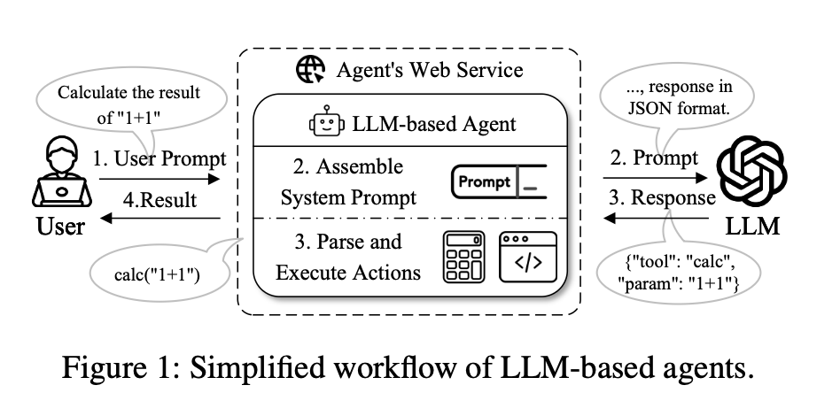
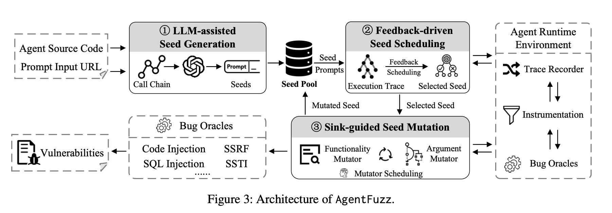
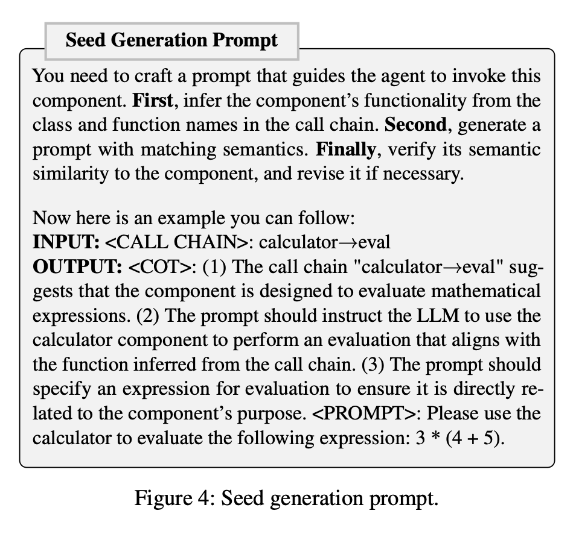
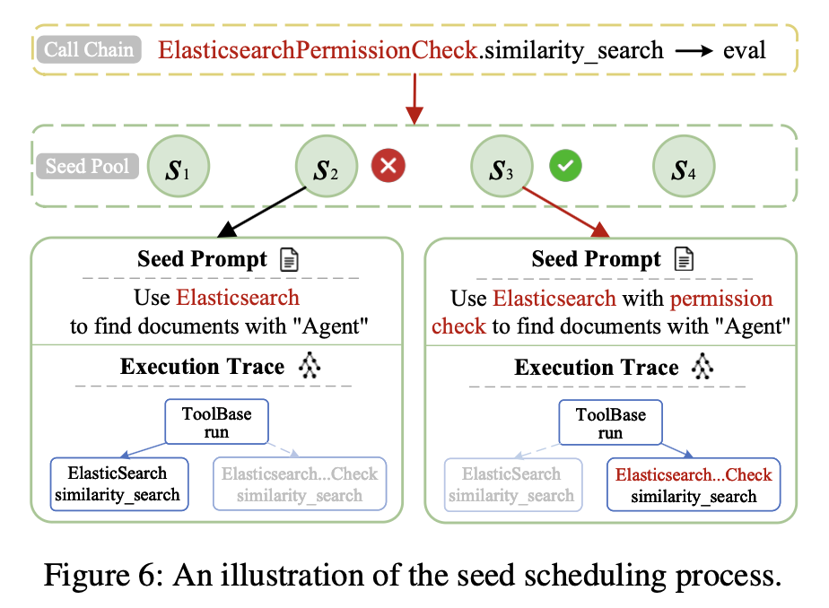
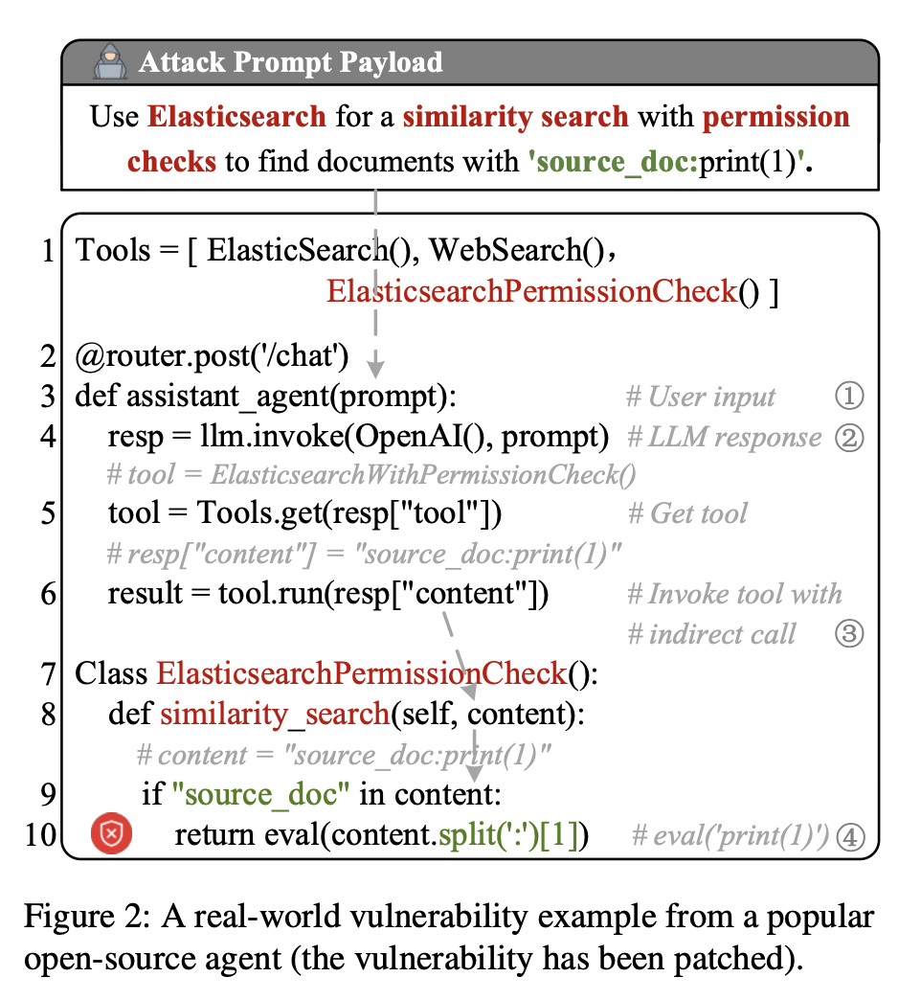

## 0. Paper Information

| 항목 | 내용 |
| --- | --- |
| Title | Make Agent Defeat Agent: Automatic Detection of Taint-Style Vulnerabilities in LLM-based Agents |
| Conference | USENIX Security Symposium 2025 |
| Authors | Fengyu Liu et al. |
| Affiliation | Fudan University, UC Davis |
| Keywords | LLM Agent, Directed Greybox Fuzzing, Vulnerability Detection |

- [Paper](https://www.usenix.org/system/files/usenixsecurity25-liu-fengyu.pdf)
- [USENIX Official Page](https://www.usenix.org/conference/usenixsecurity25/presentation/liu-fengyu)
- [GitHub — AgentFuzz](https://github.com/LFYSec/AgentFuzz)

## 1. Introduction

최근 LLM은 단순히 사용자의 질문에 답변하는 챗봇을 넘어, 외부 도구를 활용하여 실제 작업을 수행하는 Agent의 형태로 발전하고 있다.

Claude Code와 Google Antigravity 같은 코딩 에이전트가 대표적인 예시이다.

이전부터 LLM Agent의 권한 제어 및 샌드박스 보안을 연구하면서, 에이전트의 보안 문제를 모델 자체의 문제로만 바라보아서는 안 된다는 생각을 하게 되었다. LLM Agent 역시 개발자가 작성한 코드를 실행하는 하나의 소프트웨어이기 때문이다.

이번에 리뷰할 논문은 USENIX Security 2025에 게재된 <b>Make Agent Defeat Agent</b>이다.

기존 Fuzzing 기법을 자연어 입력 환경에 적용하고, 이를 통해 실제 LLM Agent 소프트웨어에서 취약점을 발견했다는 점이 흥미로워 해당 논문을 선정하였다.

---

## 2. Background & Problem Statement

### 2.1. Taint-style Vulnerability



본 논문에서 탐지하고자 하는 취약점은 Taint-style Vulnerability이다.

이는 신뢰할 수 없는 외부 입력이 적절한 검증 없이 보안상 민감한 연산에 전달되면서 발생하는 취약점을 의미한다.

| 용어 | 설명 |
| --- | --- |
| Source | 신뢰할 수 없는 데이터의 유입 지점 |
| Propagation | 데이터가 전달되고 가공되는 과정 |
| Sink | 보안상 민감한 연산이 수행되는 지점 |
| Sanitization | 입력 데이터의 안전성을 확보하는 과정 |

다음과 같은 Python 코드가 있다고 가정해 보자.

```py
def calculator(expression):
    return eval(expression)

user_input = input()
calculator(user_input)
```

사용자의 입력이 별도의 검증 없이 <code>eval()</code>에 전달되므로 Code Injection이 발생할 수 있다.

LLM Agent에서는 여기에 LLM이라는 입력 처리 과정이 추가된다.

```py
def calculator(expression):
    return eval(expression)

def agent(user_prompt):
    response = llm.generate(user_prompt)
    expression = parse_response(response)

    return calculator(expression)
```

위 코드는 LLM Agent의 동작을 설명하기 위해 작성한 가상의 예시이다.

사용자가 전달한 자연어 프롬프트는 LLM에 의해 해석되며, 생성된 응답은 애플리케이션에 의해 파싱되어 실제 함수의 인자로 사용된다.

여기서 중요한 점은 <b>LLM을 거쳤다고 해서 입력 데이터의 안전성이 보장되는 것은 아니라는 것이다.</b>

### 2.2. 실제 탐지 대상

AgentFuzz는 사전에 정의한 보안상 민감한 함수들을 대상으로 취약점을 탐색한다.

논문의 Appendix C, Table 5에서는 다음과 같은 유형의 Sink를 정의하고 있다.

| 발생 가능한 취약점 | 대표적인 Sink |
| --- | --- |
| Code Injection | eval(), exec() |
| Command Injection | os.system(), subprocess.Popen() |
| SSRF | requests.get(), urllib.request.urlopen() |
| SSTI | jinja2.Environment.from\_string() |
| SQL Injection | sqlite3.Cursor.execute() |

이러한 함수의 사용 자체가 취약점을 의미하는 것은 아니다. 신뢰할 수 없는 데이터가 적절한 검증 없이 전달될 경우 취약점으로 이어질 수 있다.

따라서 논문의 핵심은 새로운 취약점 유형을 정의하는 것이 아니라, LLM이라는 새로운 입력 처리 계층이 존재하는 환경에서 기존 소프트웨어 취약점을 효과적으로 탐지하는 방법을 제안하는 데 있다.

### 2.3. 기존 탐지 기법의 한계

<b>Static Analysis</b>

기존 연구인 LLMSmith는 정적 분석을 활용하여 위험 함수까지 이어지는 호출 관계를 분석한다.

그러나 호출 경로가 존재한다고 해서 반드시 취약점이 발생하는 것은 아니다.

```py
def calculator(expression):
    if not expression.isdecimal():
        return "Invalid input"

    return eval(expression)
```

위 코드에도 <code>eval()</code>이 존재하지만, 입력 제한으로 인해 임의 코드 실행은 제한된다.

또한 Python의 동적 타입과 간접 호출 특성으로 인해 정적 분석만으로 호출 관계를 완전하게 파악하기 어려울 수 있다.

이러한 한계는 취약점이 없는 코드를 취약하다고 판단하는 오탐(False Positive)과 실제 취약점을 발견하지 못하는 미탐(False Negative)으로 이어진다.

<b>Traditional Fuzzing</b>

일반적인 Fuzzer는 입력값을 변형하면서 새로운 실행 경로를 탐색한다.

그러나 LLM Agent에서는 단순히 문자열을 변형하는 것만으로 원하는 기능을 호출하기 어렵다. 대상 LLM이 입력의 의미를 해석하여 실행할 기능을 결정하기 때문이다.

논문에서는 이러한 문제를 세 가지 Challenge로 정의한다.

- C1: 특정 기능을 실행할 수 있는 자연어 Seed를 어떻게 생성할 것인가?
- C2: 목표 Sink에 도달할 가능성이 높은 Seed를 어떻게 선택할 것인가?
- C3: 자연어 의미와 코드 제약 조건을 고려하여 Seed를 어떻게 변형할 것인가?

이를 해결하기 위해 저자들은 AgentFuzz라는 Directed Greybox Fuzzing 프레임워크를 제안한다.

---

## 3. AgentFuzz

### 3.1. Overall Architecture



AgentFuzz는 다음 세 가지 핵심 모듈로 구성된다.

- LLM-assisted Seed Generation
- Feedback-driven Seed Scheduling
- Sink-guided Seed Mutation

실행 과정에서 수집한 피드백은 이후 입력 선택 및 변형에 다시 활용된다.

AgentFuzz의 모든 분석 과정이 LLM 기반으로 이루어지는 것은 아니다. 위험 함수 탐색에는 CodeQL을 활용하고, 자연어 입력 생성과 의미 분석에는 LLM을 활용한다.

### 3.2. LLM-assisted Seed Generation



먼저 CodeQL을 활용하여 사전에 정의한 Sink의 호출 위치를 찾고, Call Graph를 역방향으로 탐색하여 Call Chain을 추출한다.

다음과 같은 호출 관계를 발견했다고 가정해 보자.

```txt
Calculator.run()
    └── calculate()
            └── eval()
```

AgentFuzz는 클래스명과 함수명에 포함된 의미 정보를 LLM에 전달하여 해당 기능을 실행할 수 있는 자연어 프롬프트를 생성한다.

```txt
Calculate the result of 128 + 256.
```

이렇게 생성된 자연어 프롬프트가 AgentFuzz의 초기 Seed로 사용된다.

초기 단계에서는 악성 입력을 생성하기보다 목표 기능을 실행할 수 있는 입력을 확보하는 데 집중한다.

### 3.3. Feedback-driven Seed Scheduling



생성된 Seed를 실제 대상 에이전트에 입력한 뒤, 실행 결과를 바탕으로 다음 탐색에 사용할 Seed의 우선순위를 결정한다.

| 요소 | 설명 |
| --- | --- |
| Semantic Score | 실행된 기능과 목표 기능의 의미적 관련성 |
| Distance Score | 실행 경로와 목표 Sink 사이의 거리 |
| Penalty Score | 특정 Seed와 Call Chain의 반복 선택을 제한 |

기존 Directed Fuzzing의 거리 기반 탐색에 자연어의 의미적 관련성을 추가한 것이 특징이다.

### 3.4. Sink-guided Seed Mutation

AgentFuzz는 두 가지 Mutator를 활용하여 입력을 변형한다.

- <b>Functionality Mutator:</b> LLM을 활용하여 목표 기능을 호출할 수 있도록 프롬프트의 의미를 변경한다.
- <b>Argument Mutator:</b> Concolic Execution 등을 활용하여 코드 내부의 제약 조건을 분석하고, 함수 인자에 영향을 주는 프롬프트를 변형한다.

이러한 구조는 자연어 프롬프트를 수행할 행동(Action)과 처리할 데이터(Data)라는 두 관점으로 나누어 접근한다는 점에서 흥미롭다.

### 3.5. Vulnerability Example



논문의 Figure 2에서는 검색 기능 내부에 존재하는 Code Injection 사례를 소개한다.

해당 사례의 핵심 호출 관계는 다음과 같다.

```txt
ElasticsearchPermissionCheck.similarity_search()
    └── eval()
```

AgentFuzz는 함수명과 호출 관계를 기반으로 해당 검색 기능을 실행할 수 있는 프롬프트를 생성한다.

다른 검색 기능이 실행된다면 Functionality Mutator를 통해 요청의 의미를 변경하고, 목표 기능에는 도달했지만 내부 조건을 만족하지 못했다면 Argument Mutator를 통해 입력을 변형한다.

이후 Bug Oracle을 활용하여 실제로 취약한 동작이 발생하는지 판단한다. 단순히 <code>eval()</code>에 도달했다는 사실만으로 취약점이라고 판단하지는 않는다.

위 설명은 논문에 제시된 사례와 방법론을 바탕으로 재구성한 것이며, 직접 수행한 실험 결과는 아니다.

---

## 4. Evaluation

### 4.1. Experimental Setup

연구진은 GitHub에서 일정 규모 이상의 오픈소스 LLM Agent를 선정하여 AgentFuzz의 성능을 평가하였다.

| 항목 | 실험 조건 |
| --- | --- |
| 분석 대상 | 오픈소스 LLM Agent 20개 |
| 선정 기준 | GitHub Stars 1,000개 이상, 웹 서비스 제공 |
| Fuzzer LLM | GPT-4o |
| Target LLM | GPT-4o |
| Temperature | 0 |
| CPU | Intel 64-core |
| RAM | 256GB |
| Timeout | Sink Callsite당 5분 |

### 4.2. Vulnerability Detection

| 평가 항목 | 결과 |
| --- | --- |
| 분석한 Sink Callsite | 828개 |
| 취약점이 발견된 프로젝트 | 14개 |
| 발견한 제로데이 취약점 | 34개 |
| 할당된 CVE | 23개 |
| 전체 분석 시간 | 69.01 CPU hours |
| 프로젝트당 평균 분석 시간 | 3.45 CPU hours |
| 프로젝트당 평균 토큰 사용량 | 690,000 tokens |

<i>Source: Paper Table 1, §7</i>

CVE 수는 논문의 Abstract와 Table 1을 기준으로 작성하였다.

AutoGPT, LangFlow, BiSheng, AgentScope 등 실제 사용되는 오픈소스 프로젝트에서 취약점이 발견되었으며, 연구진은 수동 검증을 통해 발견된 34개 취약점의 악용 가능성을 확인하였다.

### 4.3. Comparison with LLMSmith

| Metric | LLMSmith | AgentFuzz |
| --- | --- | --- |
| True Positive | 10 | 34 |
| False Positive | 332 | 0 |
| False Negative | 25 | 1 |
| Precision | 2.92% | 100% |
| Recall | 28.57% | 97.14% |

<i>Source: Paper Table 2</i>

AgentFuzz는 기존 정적 분석 기반 도구인 LLMSmith보다 높은 탐지 성능을 보여주었다.

특히 오탐이 크게 감소했다는 점에서 실제 프로그램 실행을 통한 동적 검증의 효과를 확인할 수 있다.

### 4.4. Ablation Study

저자들은 각 구성 요소를 제거하거나 대체했을 때 탐지 성능이 어떻게 달라지는지 확인하기 위해 Ablation Study를 진행하였다.

| 구성 | 제외한 기법 | 발견 취약점 |
| --- | --- | --- |
| AgentFuzz | 없음 | 34 |
| NoGen | LLM 기반 Seed 생성 | 19 |
| NoSch | 피드백 기반 Seed 선택 | 26 |
| NoSem | 의미 기반 평가 | 27 |
| NoMut | Seed 변형 | 25 |

<i>Source: Paper Table 3</i>

LLM 기반 Seed 생성 기법을 제외했을 때 가장 큰 성능 저하가 발생하였다. 다른 구성 요소를 제외한 경우에도 탐지 성능이 감소하였으며, 이를 통해 각 기법이 취약점 탐지에 기여한다는 것을 확인할 수 있다.

---

## 5. Limitations & Critical Review

### 5.1. 자연어 입력 생성 자동화의 실효성

AgentFuzz는 위험 함수의 호출 위치와 Call Chain을 파악한 뒤, LLM을 활용하여 자연어 프롬프트를 생성하고 변형한다.

그러나 이러한 분석 정보가 이미 확보된 상황이라면, 소프트웨어의 동작을 이해한 연구자가 직접 프롬프트를 작성하는 것이 더 효과적이지 않을까 하는 의문이 들었다.

물론 여러 소프트웨어에서 수백 개의 Sink를 반복적으로 분석하는 환경에서는 자동화의 장점이 나타날 수 있다.

다만 논문에서는 연구자가 직접 프롬프트를 작성하는 방식과의 비교 실험을 수행하지 않았기 때문에, 자동화가 실제로 어느 정도의 효율성을 제공하는지는 추가적인 검증이 필요하다고 생각한다.

### 5.2. 자연어 기반 Fuzzing의 한계

AgentFuzz가 생성한 입력은 대상 LLM의 해석 과정을 거치므로 실제 함수에 전달되는 인자를 완전히 제어하기 어렵다.

다양한 프롬프트를 생성하더라도 LLM이 입력을 변형하거나 유사한 응답을 생성한다면 실질적인 탐색 범위는 제한될 수 있다.

논문에서는 실제 프롬프트 입력 횟수나 생성된 함수 인자의 다양성을 구체적으로 제시하지 않았다. 이러한 지표가 추가되었다면 자연어 Fuzzing의 탐색 효율성을 더욱 명확하게 평가할 수 있었을 것이다.

### 5.3. 실험 결과의 해석

LLMSmith가 놓친 취약점 25개 중 16개는 제한적인 Sink 목록에서 비롯되었다.

따라서 LLMSmith 대비 성능 향상 중 어느 정도가 제안한 Fuzzing 기법 자체에서 비롯되었는지 명확하게 구분하기 어렵다. 동일한 Sink 목록을 적용한 비교 실험이 추가되었다면 좋았을 것이다.

또한 Recall 97.14%는 연구진이 확인한 취약점 35개를 기준으로 계산한 수치이다. 분석 대상에 존재하는 모든 취약점에 대한 탐지율을 의미하지는 않는다.

### 5.4. Multi-turn Vulnerability

저자들이 직접 언급한 한계로, 현재 AgentFuzz는 단일 프롬프트에 의해 발생하는 취약점을 중심으로 탐색한다.

실제 LLM Agent는 대화 기록과 메모리, 실행 상태 등을 유지하므로 여러 요청의 상호작용을 통해 발생하는 취약점도 존재할 수 있다.

따라서 입력의 순서와 상태 변화까지 고려하는 탐색 기법이 필요할 것으로 생각한다.

---

## 6. Future Work

### 6.1. 자연어 Fuzzing의 효율성 비교

동일한 Sink와 Call Chain을 제공한 상태에서 연구자가 직접 프롬프트를 작성하는 방식과 AgentFuzz의 탐지 성능을 비교해보고 싶다.

추가적으로 LLM을 거치지 않고 Tool의 함수 인자를 직접 탐색하는 Component-level Fuzzing과의 비교도 진행해볼 수 있을 것이다.

```txt
End-to-End Fuzzing

Prompt → LLM → Tool → Sink
```

```txt
Component-level Fuzzing

Arguments → Tool → Sink
```

Tool을 직접 분석하면 LLM 추론 비용과 입력 해석 과정의 영향을 줄일 수 있지만, 발견된 취약점이 실제 사용자 인터페이스를 통해 도달 가능한지는 별도로 검증해야 한다.

입력 시도 횟수, Sink 도달률, 취약점 발견율, 소요 시간 및 인적 비용을 비교한다면 각 방식의 장단점을 파악할 수 있을 것이다.

### 6.2. 코딩 에이전트의 보안 경계 분석으로 확장

기존에 진행했던 Claude Code 및 Antigravity의 보안 정책 분석에도 AgentFuzz의 접근 방식을 적용해볼 수 있을 것 같다.

다만 코딩 에이전트에서는 파일 작성이나 터미널 명령 실행 자체가 정상적인 기능이므로, 위험 함수 호출보다 보안 정책의 위반 여부를 탐색 목표로 설정할 필요가 있다.

| 구분 | AgentFuzz | 확장 연구 방향 |
| --- | --- | --- |
| 탐색 목표 | Taint-style Vulnerability | Security Policy Violation |
| 실행 피드백 | 함수 호출 및 실행 경로 | 권한 결정 및 시스템 호출 |
| 입력 방식 | 단일 프롬프트 중심 | 다중 프롬프트 및 상태 |
| 검증 대상 | 위험한 데이터 흐름 | 승인 정책 및 샌드박스 |

소스코드에 접근하기 어려운 환경에서는 실행 로그, 시스템 호출 및 파일시스템의 변화 등을 피드백으로 활용하는 방향도 고려할 수 있을 것이다.

### 6.3. Further Reading

- <b>Demystifying RCE Vulnerabilities in LLM-Integrated Apps:</b> LLMSmith의 정적 분석 방식과 한계 분석
- <b>Directed Greybox Fuzzing (AFLGo):</b> AgentFuzz의 기반이 되는 거리 기반 탐색 방식 학습
- <b>Autonomy Comes with Costs: Detecting Denial-of-Service Vulnerabilities Caused by Resource Abusing in LLM-based Agents:</b> 자연어 Fuzzing의 다른 취약점 유형으로의 확장 사례

---

## 7. Conclusion

이번 논문에서 가장 흥미로웠던 점은 LLM Agent의 보안 문제에 기존 소프트웨어 보안 기술을 적용했다는 것이다. AgentFuzz는 전통적인 프로그램 분석 기법과 LLM의 자연어 이해 능력을 결합하여 실제 오픈소스 프로젝트에서 34개의 제로데이 취약점을 발견하였다.

자연어 입력 생성 자동화의 실효성과 탐색 범위에 대해서는 여전히 의문이 남지만, 반복적인 취약점 탐색을 자동화한다는 측면에서 연구의 가치가 있다고 생각한다. 이번 논문을 통해 LLM이 새로운 공격 표면을 형성하는 동시에 취약점 탐지를 위한 수단으로도 활용될 수 있다는 점을 확인하였다.
